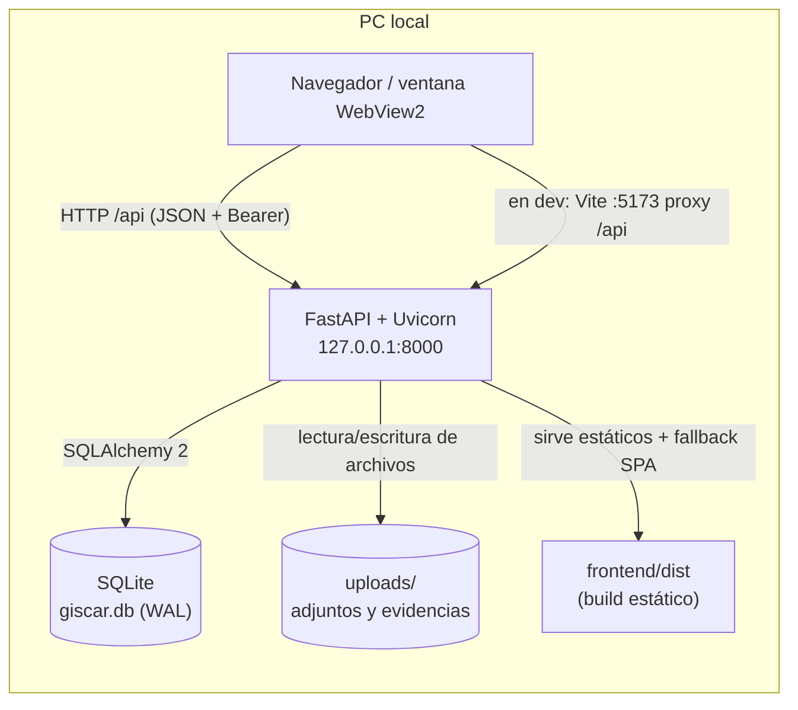
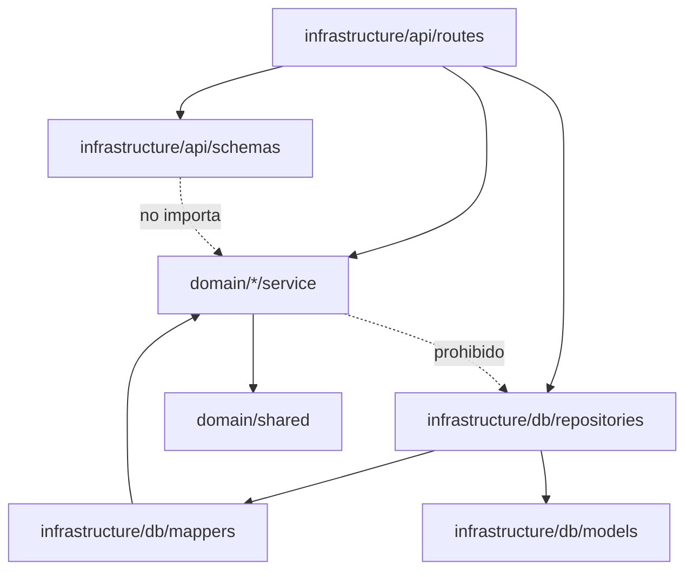
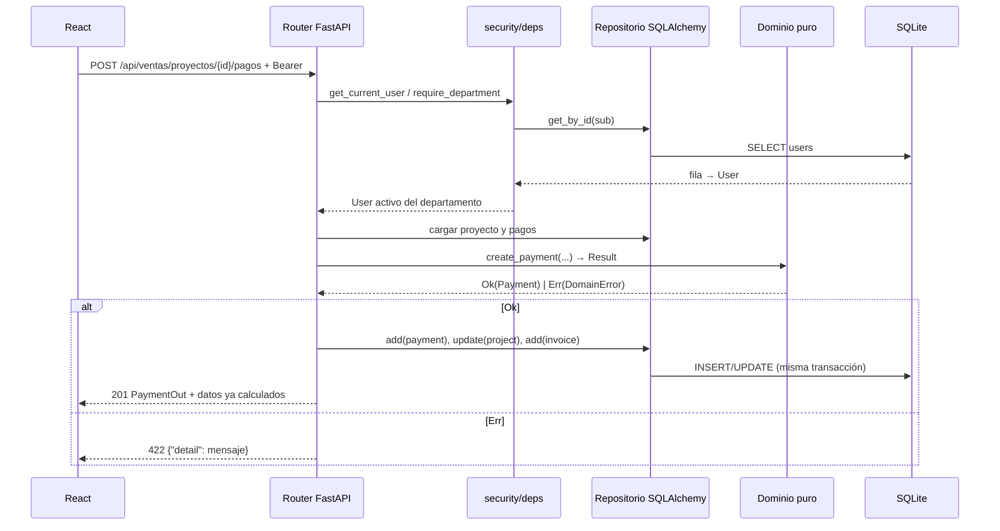

# 01 · Arquitectura

## 1. Contexto y restricciones

GCISCAR es un sistema **monousuario desplegado en una sola PC** (aunque lo usen 25–100
personas de la empresa a través de esa máquina o de su red local). Restricciones que
gobiernan todas las decisiones:

- **Sin internet en ejecución.** Fuentes, iconos y assets se sirven localmente.
- **Un solo proceso de negocio.** No hay microservicios ni colas externas.
- **SQLite obligatorio**, archivo único con WAL.
- **Facturación solo interna**: se registra el cobro y se emite un PDF; no hay pasarela.
- **Español** en toda la interfaz, mensajes y documentos.
- **Frontend pasivo**: la UI no calcula reglas de negocio.

## 2. Vista de contenedores



En desarrollo hay **dos procesos** (Vite en `:5173` y Uvicorn en `:8000`). En producción
hay **uno**: FastAPI sirve la API y el build del frontend desde el mismo origen. En el
`.exe`, un lanzador arranca Uvicorn en un hilo y abre una ventana WebView2.

## 3. Capas del backend

```
backend/app/
  domain/           # PURO: stdlib + domain/shared. Sin FastAPI, SQLAlchemy ni Pydantic.
    shared/         #   Result/Err/DomainError, Money, StateMachine, HOFs
    user/ customer/ project/ payment/ invoice/
    development/ dispatch/ incidence/ attachment/ audit/ search/
  application/      # Casos de uso (VACÍO en la práctica; ver deuda técnica)
  infrastructure/
    api/routes/     # Routers FastAPI delgados
    api/schemas*.py # Contratos Pydantic de entrada/salida
    db/             # Modelos SQLAlchemy, mappers, repositorios, seed, sesión
    security/       # Argon2, JWT, dependencias de auth/RBAC
    storage/        # Escritura/lectura de uploads
  main.py           # create_app, CORS, routers, estáticos, startup (init_db + seed)
  config.py         # Settings (pydantic-settings, prefijo GISCAR_)
```

### Regla de dependencia



- `domain/` no importa FastAPI, SQLAlchemy, Pydantic ni `infrastructure/`.
- `infrastructure/` traduce entre filas, dominio y HTTP.
- Los routers **no contienen reglas de negocio**: validan con Pydantic, llaman al dominio,
  traducen `Result` a HTTP y persisten.

## 4. Patrones aplicados

### 4.1 Inmutabilidad

- Todos los modelos de dominio son `@dataclass(frozen=True, slots=True)`.
- Los cambios se hacen con `dataclasses.replace(...)` y se devuelven como **nueva**
  instancia. Nunca se asigna a un campo.
- Los agregados exponen métodos/`classmethods` que construyen valores por defecto
  (`Project.new_state_fields()`).

### 4.2 `Result` en vez de excepciones

`domain/shared/types.py` define:

```python
Ok(value) | Err(DomainError(code, message))
map_result / and_then / unwrap_or / collect / partition
```

- Los errores de negocio esperados (estado inválido, saldo insuficiente, usuario
  bloqueado, validación) devuelven `Err`.
- `raise` solo para errores de programación (`UnwrapError`, `Money` negativo).
- La infraestructura traduce: `Err` → HTTP 4xx con `detail` legible; `Ok` → 2xx + esquema.

### 4.3 Funciones puras

Los `service.py` de dominio:

- No acceden a BD, disco, red, reloj ni entorno.
- Reciben `now: datetime`, `id: str` y datos ya cargados.
- Devuelven valores nuevos.

La infraestructura inyecta tiempo (`datetime.now(UTC)`), IDs (`uuid4().hex`) y
persistencia (`Session`).

### 4.4 HOFs

`domain/shared/functions.py` ofrece `pipe`, `compose`, `curried_map/filter/reduce`,
`sum_by`, `count_where`, `group_by`, `sort_by`, `unique_by`, `find_first`, `all_match`,
`any_match`, `clamp`. Los servicios las usan en lugar de bucles con mutación.

### 4.5 Máquina de estados

`domain/shared/state_machine.py` define un grafo genérico `StateMachine(initial,
transitions)` con `allowed_targets`, `can_transition` y `next` (devuelve `Result`).
`domain/project/states.py` instancia tres máquinas (Ventas, Producción, Despacho) y
`domain/project/service.py` las aplica con `dataclasses.replace`.

### 4.6 Puertos y adaptadores

Los repositorios concretos viven en `infrastructure/db/repositories/`. En la práctica no
existe un `Protocol` formal en `domain/`: los routers instancian repositorios concretos.
Esto es una desviación consciente del plan (ver §7).

### 4.7 Dinero

`Money(cents: int)`:

- Se construye con `Money.from_amount(Decimal|str|float)` y redondeo `ROUND_HALF_UP`.
- Se persiste como `INTEGER` en centavos en `projects`, `payments` e `invoices`.
- La API expone `float` en unidades monetarias (DOP) solo en el borde.
- `percent()` redondea a centavos; `plus`/`minus` validan negativos.

## 5. Flujo de una petición



Detalles:

- Una sesión SQLAlchemy por request (`get_db`, `SessionLocal`).
- Varias escrituras por endpoint comparten transacción; `db.commit()` al final. Si una
  validación falla antes del commit, no se escribe nada.
- Los valores derivados (`pagado`, `saldo`, `acciones`, columnas de tablero, contadores,
  KPIs) los calcula el backend y viajan en el JSON.

## 6. Contratos clave entre capas

| Concepto | Dominio | HTTP |
|---|---|---|
| Dinero | `Money` (centavos) | `float` en DOP |
| Error de negocio | `Err(DomainError(code, message))` | `4xx {"detail": message}` |
| Estado | `str` validado por `StateMachine` | `str` en JSON |
| Acciones permitidas | `tuple[str, ...]` | `acciones: string[]` |
| Listados agrupados | `dict[grupo, tuple[Project, ...]]` | `{grupo: Project[]}` |
| Fechas | `datetime` UTC | ISO-8601 |
| Archivos | `Attachment` + bytes en disco | `multipart/form-data` / `FileResponse` |

## 7. Decisiones y deuda técnica

| Tema | Estado actual | Implicación |
|---|---|---|
| `application/` | Vacío; los routers orquestan y llaman al dominio | No hay casos de uso reutilizables ni tests de aplicación; rutas más gordas de lo previsto |
| Repositorios | Clases concretas, sin `Protocol` en dominio | El dominio sigue puro, pero no se puede sustituir la persistencia sin tocar rutas |
| Frontend pasivo | Se respeta en general | Excepciones menores: contador de resultados de búsqueda y `rutaResultado()` (presentación) |
| Guardas de ruta React | Solo comprueban que exista token | Un usuario puede abrir una URL de otro módulo; el backend responde 403 |
| RRHH | `User.can_access()` deja pasar a RRHH por cualquier `require_department` | RRHH tiene acceso **de escritura** por API a todos los módulos, no solo lectura |
| Migraciones | `Base.metadata.create_all` + `ALTER TABLE` ad-hoc en `init_db` | No hay Alembic; los cambios de esquema requieren parches manuales e idempotentes |
| Rate limiting | No implementado | El login no limita intentos |
| `frontend/src/App.tsx` | Resto del template de Vite, no se importa | Archivo huérfano; `main.tsx` usa `src/app/App.tsx` |
| Tests de frontend | No hay framework configurado | Solo typecheck + oxlint + build |
| Concurrencia | SQLite WAL + `busy_timeout=5000` | Suficiente para un PC; escrituras concurrentes se serializan |
| Secretos por defecto | `jwt_secret` y `giscar1234` en código/config | Deben cambiarse por entorno en uso real |

## 8. Escalabilidad y evolución

- **SQLite** soporta el uso previsto; el límite práctico es la escritura concurrente, no
  el volumen. Migrar a PostgreSQL implicaría cambiar `database_url` y revisar los
  `ALTER TABLE`/PRAGMAs de `session.py`.
- La separación dominio/infraestructura permite migrar la persistencia sin reescribir
  las reglas de negocio.
- Un futuro `application/` debería recibir repositorios inyectados y devolver `Result`,
  dejando los routers aún más delgados.
