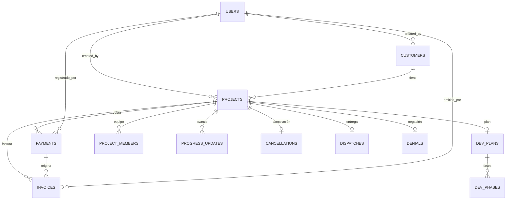
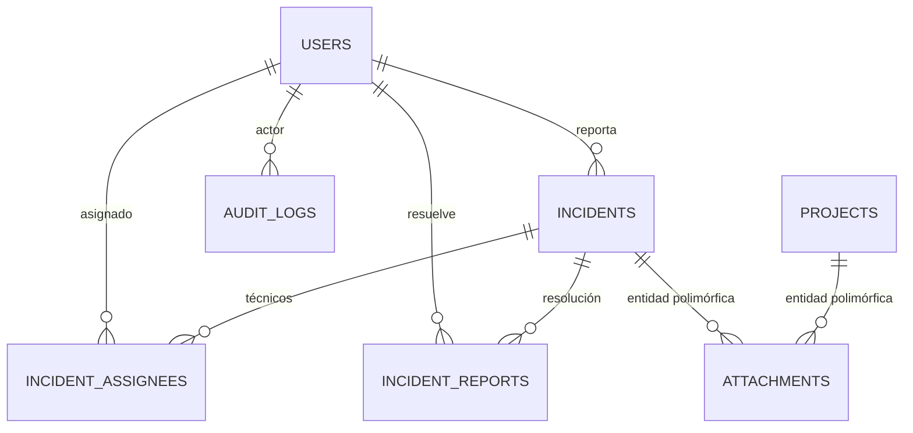

# 04 · Base de datos

## 1. Motor y configuración

- **SQLite** en un archivo único (`giscar.db`), gestionado con SQLAlchemy 2.
- `DATABASE_URL` por defecto:
  - desarrollo: `sqlite:///backend/giscar.db`
  - `.exe`: `%LOCALAPPDATA%\GCISCAR\giscar.db`
- PRAGMAs aplicados en cada conexión (`infrastructure/db/session.py`):

```sql
PRAGMA journal_mode = WAL;     -- lectores concurrentes
PRAGMA foreign_keys = ON;      -- integridad referencial
PRAGMA busy_timeout = 5000;    -- espera 5 s si la BD está bloqueada
```

- `create_engine(..., check_same_thread=False, pool_pre_ping=True)`.
- Sesión: `autoflush=False`, `autocommit=False`, `expire_on_commit=False`.
- Una sesión por request (`get_db`); `commit()` explícito al final de cada mutación.

Archivos en disco: `giscar.db`, `giscar.db-wal`, `giscar.db-shm`.

## 2. Convenciones

- **IDs**: `String(32)` con `uuid4().hex` (`new_id()`), generados en aplicación.
- **Fechas**: `DateTime(timezone=True)` en UTC (`utcnow()`); SQLite las guarda como texto.
- **Fechas sin hora**: `Date` (`dev_phases`, `dispatches`).
- **Dinero**: `Integer` en **centavos** (`projects.monto_total`, `payments.monto`,
  `invoices.monto`). La API convierte a unidades (`float`) en el borde.
- **Estados**: `String`, validados por las máquinas de estado del dominio.
- **JSON**: `invoices.snapshot` es texto JSON con una copia inmutable del proyecto.
- **Borrado**: solo clientes sin proyectos. Usuarios y evidencias no se borran
  (baja lógica `desactivado`).
- Sin `ON DELETE CASCADE` salvo la relación ORM de `incidents.assignees`
  (`delete-orphan`, aplicada en la sesión).

## 3. Diagrama entidad-relación — núcleo del expediente



## 4. Diagrama — soporte transversal



`attachments` no tiene FK a la entidad: usa `(entidad_tipo, entidad_id)` polimórfico.
`audit_logs.user_id` tampoco declara FK (el actor puede haberse eliminado o el log
registrar un email desconocido).

## 5. Tablas

### 5.1 `users`

| Columna | Tipo | Notas |
|---|---|---|
| `id` | VARCHAR(32) PK | uuid hex |
| `email` | VARCHAR(255) | **UNIQUE**, indexado, minúsculas |
| `password_hash` | VARCHAR(255) | Argon2 |
| `nombre` | VARCHAR(255) | |
| `documento` | VARCHAR(50) | nullable |
| `telefono` | VARCHAR(50) | nullable, solo dígitos |
| `direccion` | TEXT | nullable |
| `cargo` | VARCHAR(100) | nullable |
| `departamento` | VARCHAR(20) | indexado: `ventas/desarrollo/despacho/tecnologia/rrhh` |
| `estado` | VARCHAR(20) | default `activo`; también `bloqueado`, `desactivado` |
| `created_at`, `updated_at` | DATETIME | UTC |

### 5.2 `customers`

| Columna | Tipo | Notas |
|---|---|---|
| `id` | VARCHAR(32) PK | |
| `nombre` | VARCHAR(255) | empresa |
| `representante` | VARCHAR(255) | nullable por registros antiguos; obligatorio en altas |
| `documento` | VARCHAR(50) | RIF/cédula |
| `telefono` | VARCHAR(50) | solo dígitos |
| `email` | VARCHAR(255) | nullable |
| `direccion` | TEXT | |
| `notas` | TEXT | |
| `created_by` | VARCHAR(32) FK `users.id` | |
| `created_at`, `updated_at` | DATETIME | |

### 5.3 `projects` (agregado central)

| Columna | Tipo | Notas |
|---|---|---|
| `id` | VARCHAR(32) PK | |
| `codigo` | VARCHAR(30) | **UNIQUE**, indexado, `PRJ-YYYY-NNNN` |
| `titulo` | VARCHAR(255) | derivado de los detalles si no se envía |
| `descripcion_detallada` | TEXT | ≥ 20 caracteres |
| `customer_id` | VARCHAR(32) FK `customers.id` | |
| `monto_total` | INTEGER | **centavos** |
| `contacto_nombre` | VARCHAR(255) | snapshot para Despacho |
| `contacto_telefono` | VARCHAR(50) | nullable |
| `contacto_email` | VARCHAR(255) | nullable |
| `contacto_direccion` | TEXT | nullable |
| `estado_ventas` | VARCHAR(30) | default `levantamiento` |
| `estado_desarrollo` | VARCHAR(30) | default `pendiente` |
| `estado_despacho` | VARCHAR(30) | default `pendiente` |
| `created_by` | VARCHAR(32) FK `users.id` | |
| `created_at`, `updated_at` | DATETIME | |

### 5.4 `payments`

| Columna | Tipo | Notas |
|---|---|---|
| `id` | VARCHAR(32) PK | |
| `project_id` | VARCHAR(32) FK `projects.id` | indexado |
| `monto` | INTEGER | centavos |
| `porcentaje` | INTEGER | acumulado 0–100 |
| `tipo` | VARCHAR(20) | `anticipo/liquidacion/total` |
| `metodo_pago` | VARCHAR(50) | |
| `notas` | TEXT | nullable |
| `registrado_por` | VARCHAR(32) FK `users.id` | |
| `fecha` | DATETIME | UTC |

### 5.5 `invoices`

| Columna | Tipo | Notas |
|---|---|---|
| `id` | VARCHAR(32) PK | |
| `numero` | VARCHAR(30) | **UNIQUE**, `FAC-YYYY-NNNNN` |
| `project_id` | VARCHAR(32) FK `projects.id` | indexado |
| `payment_id` | VARCHAR(32) FK `payments.id` | 1 factura por pago de Ventas |
| `monto` | INTEGER | centavos |
| `porcentaje` | INTEGER | |
| `metodo_pago` | VARCHAR(50) | |
| `descripcion` | TEXT | |
| `snapshot` | TEXT | JSON del proyecto/cliente al emitir |
| `emitida_por` | VARCHAR(32) FK `users.id` | |
| `emitida_en` | DATETIME | |

### 5.6 `dev_plans`

| Columna | Tipo | Notas |
|---|---|---|
| `id` | VARCHAR(32) PK | |
| `project_id` | VARCHAR(32) FK `projects.id` | indexado; **1 plan por proyecto** (regla de aplicación, sin UNIQUE) |
| `resumen` | TEXT | |
| `objetivos` | TEXT | puede ir vacío |
| `horas_estimadas` | INTEGER | > 0 |
| `created_by` | VARCHAR(32) FK `users.id` | |
| `created_at`, `updated_at` | DATETIME | |

### 5.7 `dev_phases`

| Columna | Tipo | Notas |
|---|---|---|
| `id` | VARCHAR(32) PK | |
| `plan_id` | VARCHAR(32) FK `dev_plans.id` | indexado |
| `orden` | INTEGER | ≥ 1 |
| `nombre` | VARCHAR(255) | |
| `descripcion` | TEXT | |
| `fecha_inicio`, `fecha_fin_estimada`, `fecha_fin_real` | DATE | nullable |
| `horas_estimadas`, `horas_reales` | INTEGER | |
| `estado` | VARCHAR(20) | `pendiente/en_curso/completada` |

### 5.8 `project_members`

| Columna | Tipo | Notas |
|---|---|---|
| `id` | VARCHAR(32) PK | |
| `project_id` | VARCHAR(32) FK `projects.id` | indexado |
| `user_id` | VARCHAR(32) FK `users.id` | indexado; solo usuarios de `desarrollo` |
| `rol_proyecto` | VARCHAR(100) | por ahora siempre `Miembro` |
| `fecha_asignacion` | DATETIME | |

### 5.9 `progress_updates`

| Columna | Tipo | Notas |
|---|---|---|
| `id` | VARCHAR(32) PK | |
| `project_id` | VARCHAR(32) FK `projects.id` | indexado |
| `phase_id` | VARCHAR(32) FK `dev_phases.id` | nullable |
| `user_id` | VARCHAR(32) FK `users.id` | |
| `porcentaje` | INTEGER | 0–100 |
| `notas` | TEXT | obligatorias |
| `fecha` | DATETIME | |

### 5.10 `cancellations`

| Columna | Tipo | Notas |
|---|---|---|
| `id` | VARCHAR(32) PK | |
| `project_id` | VARCHAR(32) FK `projects.id` | indexado; 1 por proyecto en la práctica |
| `motivo` | VARCHAR(255) | |
| `informe` | TEXT | ≥ 30 caracteres |
| `cancelado_por` | VARCHAR(32) FK `users.id` | |
| `fecha` | DATETIME | |

### 5.11 `attachments`

| Columna | Tipo | Notas |
|---|---|---|
| `id` | VARCHAR(32) PK | |
| `entidad_tipo` | VARCHAR(20) | indexado (`proyecto`, `plan`, `fase`, `cancelacion`, `despacho`, `incidencia`, `factura`) |
| `entidad_id` | VARCHAR(32) | indexado |
| `nombre` | VARCHAR(255) | nombre original saneado |
| `ruta` | VARCHAR(500) | nombre en disco: `<id>_<nombre>` |
| `mime` | VARCHAR(100) | validado contra lista blanca |
| `tamano` | INTEGER | bytes |
| `subido_por` | VARCHAR(32) FK `users.id` | |
| `fecha` | DATETIME | |

### 5.12 `dispatches`

| Columna | Tipo | Notas |
|---|---|---|
| `id` | VARCHAR(32) PK | |
| `project_id` | VARCHAR(32) FK `projects.id` | indexado |
| `fecha_entrega` | DATE | nullable en BD, obligatoria al confirmar |
| `hora_entrega` | VARCHAR(10) | nullable |
| `destinatario` | VARCHAR(255) | nullable en BD |
| `detalle_entregado` | TEXT | nullable en BD |
| `notas` | TEXT | nullable |
| `confirmado_por` | VARCHAR(32) FK `users.id` | |
| `fecha_registro` | DATETIME | |

### 5.13 `denials`

| Columna | Tipo | Notas |
|---|---|---|
| `id` | VARCHAR(32) PK | |
| `project_id` | VARCHAR(32) FK `projects.id` | indexado |
| `motivo` | VARCHAR(255) | |
| `detalle` | TEXT | ≥ 15 caracteres |
| `registrado_por` | VARCHAR(32) FK `users.id` | |
| `fecha` | DATETIME | |

### 5.14 `incidents`

| Columna | Tipo | Notas |
|---|---|---|
| `id` | VARCHAR(32) PK | |
| `codigo` | VARCHAR(30) | **UNIQUE**, indexado, `INC-YYYY-NNNN` |
| `titulo` | VARCHAR(255) | |
| `descripcion` | TEXT | ≥ 15 caracteres |
| `equipo_afectado` | VARCHAR(255) | |
| `departamento_origen` | VARCHAR(20) | quien reporta |
| `prioridad` | VARCHAR(20) | `baja/media/alta/critica` |
| `estado` | VARCHAR(20) | default `abierta` |
| `orden_llegada` | INTEGER | consecutivo global |
| `reportado_por` | VARCHAR(32) FK `users.id` | |
| `asignado_a` | VARCHAR(32) FK `users.id` | **legado**; se migra a `incident_assignees` y se pone a NULL |
| `created_at`, `updated_at` | DATETIME | |

### 5.15 `incident_assignees`

| Columna | Tipo | Notas |
|---|---|---|
| `id` | VARCHAR(32) PK | |
| `incident_id` | VARCHAR(32) FK `incidents.id` | indexado |
| `user_id` | VARCHAR(32) FK `users.id` | indexado |

Varios técnicos por incidencia; sin UNIQUE `(incident_id, user_id)` (el dominio
deduplica antes de guardar).

### 5.16 `incident_reports`

| Columna | Tipo | Notas |
|---|---|---|
| `id` | VARCHAR(32) PK | |
| `incident_id` | VARCHAR(32) FK `incidents.id` | indexado |
| `diagnostico` | TEXT | ≥ 10 |
| `solucion` | TEXT | ≥ 10 |
| `tiempo_resolucion_horas` | INTEGER | ≥ 0 |
| `resuelto_por` | VARCHAR(32) FK `users.id` | |
| `fecha` | DATETIME | |

### 5.17 `audit_logs`

| Columna | Tipo | Notas |
|---|---|---|
| `id` | VARCHAR(32) PK | |
| `user_id` | VARCHAR(32) | nullable, sin FK |
| `user_email` | VARCHAR(255) | nullable |
| `accion` | VARCHAR(50) | indexado, whitelist |
| `entidad_tipo` | VARCHAR(30) | nullable |
| `entidad_id` | VARCHAR(32) | nullable |
| `detalle` | TEXT | nullable |
| `ip` | VARCHAR(50) | nullable; **hoy nunca se rellena** |
| `fecha` | DATETIME | indexado |

## 6. Índices y restricciones

| Tabla | Índice / restricción |
|---|---|
| `users` | PK; email UNIQUE; email, departamento |
| `customers` | PK |
| `projects` | PK; codigo UNIQUE; codigo; customer_id (FK, sin índice explícito) |
| `payments` | PK; project_id |
| `invoices` | PK; numero UNIQUE; project_id |
| `dev_plans` | PK; project_id |
| `dev_phases` | PK; plan_id |
| `project_members` | PK; project_id; user_id |
| `progress_updates` | PK; project_id; phase_id (FK) |
| `cancellations` | PK; project_id |
| `attachments` | PK; entidad_tipo; entidad_id |
| `dispatches` | PK; project_id |
| `denials` | PK; project_id |
| `incidents` | PK; codigo UNIQUE; codigo |
| `incident_assignees` | PK; incident_id; user_id |
| `incident_reports` | PK; incident_id |
| `audit_logs` | PK; user_id; accion; fecha |

No hay restricciones UNIQUE para: plan por proyecto, entrega por proyecto, negación por
proyecto. Son reglas de aplicación; una inserción concurrente podría duplicarlas (no
ocurre en el uso previsto de un solo PC).

## 7. Migraciones y evolución

No se usa Alembic. `init_db()` hace `create_all` y luego parches idempotentes:

```sql
-- 1) customers.representante (altas nuevas)
ALTER TABLE customers ADD COLUMN representante VARCHAR(255);   -- solo si falta

-- 2) incidents.asignado_a → incident_assignees
INSERT INTO incident_assignees (id, incident_id, user_id)
SELECT lower(hex(randomblob(16))), id, asignado_a FROM incidents
WHERE asignado_a IS NOT NULL;
UPDATE incidents SET asignado_a = NULL;

-- 3) proyectos en Despacho con saldo pendiente
UPDATE projects SET estado_despacho = 'pendiente_cobro'
WHERE estado_despacho = 'pendiente_entrega'
  AND estado_desarrollo = 'enviado_despacho'
  AND monto_total > COALESCE((SELECT SUM(monto) FROM payments
                              WHERE payments.project_id = projects.id), 0);
```

**Consecuencias:**

- Un cambio de esquema debe añadirse a `init_db` de forma segura para bases existentes.
- No hay historial de versiones ni downgrade.
- `create_all` no añade columnas ni índices a tablas ya creadas.
- Para desarrollo se puede borrar la BD y volver a sembrar.

## 8. Operación

### Resetear la base (borra todo)

```bash
cd backend
rm -f giscar.db giscar.db-wal giscar.db-shm
uv run python -m app.infrastructure.db.seed
```

### Backup en caliente

Con WAL, copiar los tres archivos (`giscar.db`, `-wal`, `-shm`) o, mejor, usar la API de
backup de SQLite:

```bash
sqlite3 giscar.db ".backup 'giscar-backup.db'"
```

En la instalación, la ruta es `%LOCALAPPDATA%\GCISCAR\giscar.db`.

### Tamaño y rendimiento

- Un proyecto usa pocas decenas de filas; el volumen esperado (cientos/miles) es trivial.
- Los listados de tablero cargan todos los proyectos y agregan en memoria (dominio puro).
  Con decenas de miles de proyectos habría que paginar/filtrar en SQL.
- La numeración (`PRJ`, `FAC`, `INC`) se calcula leyendo todos los códigos del año; no es
  atómica frente a concurrencia.

## 9. Consultas de diagnóstico útiles

```sql
-- Proyectos por estado
SELECT estado_ventas, estado_desarrollo, estado_despacho, COUNT(*)
FROM projects GROUP BY 1,2,3;

-- Saldo por proyecto (centavos)
SELECT p.codigo, p.monto_total,
       COALESCE(SUM(pg.monto),0) AS pagado,
       p.monto_total - COALESCE(SUM(pg.monto),0) AS saldo
FROM projects p LEFT JOIN payments pg ON pg.project_id = p.id
GROUP BY p.id;

-- Incidencias activas por prioridad
SELECT prioridad, COUNT(*) FROM incidents
WHERE estado NOT IN ('resuelta','cerrada') GROUP BY prioridad;

-- Últimas acciones auditadas
SELECT fecha, user_email, accion, entidad_tipo, entidad_id, detalle
FROM audit_logs ORDER BY fecha DESC LIMIT 50;
```
