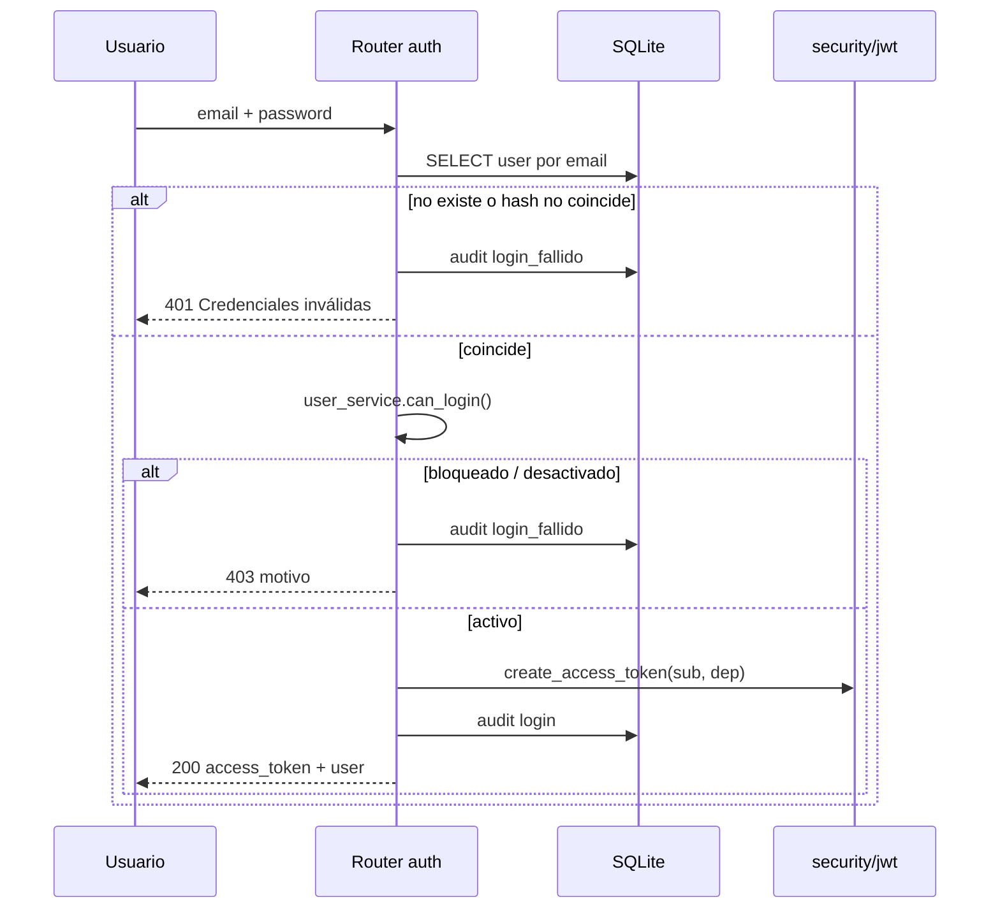

# 06 · Seguridad

## 1. Modelo de amenaza

GCISCAR está pensado para **una PC local**, sin exposición a internet y con usuarios
internos. Las amenazas relevantes son:

| Amenaza | Superficie |
|---|---|
| Acceso físico a la PC | Archivo SQLite, `uploads/`, `.env`, sesión en `localStorage` |
| Usuario interno con credenciales | Intentar acciones de otro departamento por API |
| Fuerza bruta al login | Sin rate limiting |
| Archivos maliciosos | Subida de adjuntos/evidencias |
| XSS / inyección | Formularios y campos de texto |
| Divulgación de datos | Adjuntos y facturas descargables con solo un ID |
| Pérdida de datos | Sin backup automático |

Quedan **fuera de alcance**: ataques de red, TLS, multitenencia, cumplimiento normativo
formal y alta disponibilidad.

## 2. Autenticación

### 2.1 Contraseñas

`infrastructure/security/password.py`:

```python
PasswordHasher(time_cost=2, memory_cost=64 * 1024, parallelism=2)  # Argon2
```

- Hash Argon2 (formato `$argon2id$...`) en `users.password_hash`.
- Verificación con `VerifyMismatchError` / `VerificationError` → `False`.
- Nunca se guarda ni se registra la contraseña en claro.
- El seed usa `SEED_PASSWORD = "giscar1234"`; el alta de usuarios exige mínimo 8
  caracteres (Pydantic).

### 2.2 Login

`POST /api/auth/login`:



- Mismo mensaje (`Credenciales inválidas`) para email inexistente y contraseña errónea:
  evita enumerar usuarios.
- El usuario bloqueado sí recibe un mensaje específico (decisión de UX).
- `audit_logs` registra email intentado en `login_fallido`, con o sin `user_id`.

### 2.3 Token

`infrastructure/security/jwt.py`:

| Claim | Valor |
|---|---|
| `sub` | id del usuario |
| `dep` | departamento al emitir |
| `exp` | ahora + `access_token_minutes` (480 min por defecto) |
| `iat` | ahora |

- Algoritmo **HS256**, secreto `GISCAR_JWT_SECRET`.
- `decode_token` devuelve `Result`; cualquier `PyJWTError` → 401.
- No hay refresh token ni revocación por lista negra. La sesión termina al expirar o al
  limpiar el cliente.

### 2.4 Validación por request

`get_current_user` (`security/deps.py`):

1. Lee `Authorization: Bearer`.
2. Decodifica el JWT.
3. Extrae `sub`.
4. **Carga el usuario desde la BD** (no confía en `dep` del token).
5. Exige que exista y esté `activo`.

Consecuencias positivas:

- Bloquear/desactivar a un usuario invalida su token **de inmediato**.
- Cambiar su departamento surte efecto en la siguiente petición.
- El claim `dep` queda informativo; la autorización usa el estado actual.

### 2.5 Sesión en el cliente

- Zustand `persist` guarda `token` y `user` en `localStorage` (`giscar-auth`).
- `api.client` añade el header automáticamente.
- Un `401` con token limpia la sesión y muestra «Sesión expirada».
- No hay cierre de sesión por inactividad; el token dura 8 h.
- Riesgo: en una PC compartida, otra persona puede reutilizar la sesión guardada mientras
  el token siga vigente.

## 3. Autorización

### 3.1 Mecanismo

`require_department(*deps)` comprueba:

```python
user.departamento in deps or user.departamento == Departamento.RRHH
```

Se aplica como dependencia de FastAPI en cada router. No hay permisos por recurso ni por
propietario: **todo el departamento ve todo su módulo**.

### 3.2 Matriz de acceso por módulo

| Módulo / ruta | Ventas | Producción | Despacho | Tecnología | RRHH |
|---|:---:|:---:|:---:|:---:|:---:|
| `/api/auth/me`, `/api/panel`, `/api/buscar` | ✅ | ✅ | ✅ | ✅ | ✅ |
| `/api/auth/usuarios` (gestión) | ❌ | ❌ | ❌ | ❌ | ✅ |
| `/api/ventas/*` | ✅ | ❌ | ❌ | ❌ | ✅* |
| `/api/ventas/facturas/{id}/pdf` | ✅ | ❌ | ✅ | ❌ | ✅ |
| `/api/desarrollo/*` | ❌ | ✅ | ❌ | ❌ | ✅* |
| `/api/desarrollo/adjuntos/*` | ✅ | ✅ | ✅ | ✅ | ✅ |
| `/api/despacho/*` | ❌ | ❌ | ✅ | ❌ | ✅* |
| `/api/tecnologia/incidencias` (POST) | ✅ | ✅ | ✅ | ✅ | ✅ |
| `/api/tecnologia/*` (gestión) | ❌ | ❌ | ❌ | ✅ | ✅* |
| `/api/rrhh/*` | ❌ | ❌ | ❌ | ❌ | ✅ |

`*` RRHH pasa todos los `require_department` por `User.can_access()`. Es un **acceso
funcional completo (lectura y escritura)**, no solo lectura, aunque la UI de RRHH solo
exponga vistas de consulta y gestión de usuarios. Si se requiere lectura estricta, hay
que separar `require_department` de `require_read_department` o eliminar el bypass de
RRHH y añadirlo explícitamente solo en rutas de lectura.

### 3.3 Alcance de los datos

- Proyectos: cualquier usuario de Ventas ve todos los proyectos, no solo los suyos.
- Producción y Despacho ven el tablero completo de su módulo.
- Tecnología ve todas las incidencias.
- RRHH ve todo.
- La búsqueda respeta categorías por departamento (`domain/search/service.py`).
- Los contadores del panel solo incluyen departamentos visibles.

No existe filtrado por `created_by` ni por equipo asignado.

### 3.4 Frontend

- `ProtectedRoute` solo exige token.
- El router no valida rol; el sidebar oculta enlaces por departamento.
- Escribir manualmente `/rrhh/usuarios` con sesión de Ventas renderiza la página, pero las
  llamadas fallan con 403.
- **La seguridad efectiva está en el backend**, correctamente.

### 3.5 Reglas de negocio como control

Además del RBAC, el dominio impide operaciones inseguras o incoherentes:

- No se puede bloquear/desactivar al último RRHH activo ni a uno mismo.
- No se puede entregar con saldo pendiente.
- No se puede pasar a Producción sin ≥ 50 % cobrado.
- No se puede completar Producción con fases abiertas.
- No se puede cancelar sin informe ≥ 30 caracteres.
- No se puede asignar una incidencia cerrada.
- No se puede borrar un cliente con proyectos.

## 4. Validación en fronteras

| Frontera | Herramienta | Ejemplos |
|---|---|---|
| HTTP body/query | Pydantic | `EmailStr`, `min_length`, `gt=0`, `pattern` de prioridad, enums |
| Reglas de negocio | Dominio puro | saldo, estados, 50 %, fases, último RRHH |
| Base de datos | SQLAlchemy + FKs | integridad referencial (`foreign_keys=ON`) |
| Archivos | Dominio + config | MIME, tamaño, nombre saneado |
| Frontend | HTML5 | `required`, `minLength` (solo UX) |

El servidor **revalida todo**; el HTML del cliente no es un control de seguridad.

## 5. Subida y descarga de archivos

### Subida (`POST /api/desarrollo/adjuntos/{tipo}/{id}`)

1. El usuario debe pertenecer a Ventas, Producción, Despacho o Tecnología (o RRHH).
2. `validate_entidad_tipo` exige un tipo de la lista.
3. Se lee el archivo completo en memoria (`await file.read()`), lo que limita el impacto
   del tamaño máximo configurado.
4. `validate_upload`:
   - nombre no vacío;
   - `content_type` en lista blanca (PDF, imágenes, texto, Office);
   - `0 < tamaño ≤ 20 MB`.
5. `safe_filename` reemplaza caracteres no seguros y prefija el UUID:
   `re.sub(r"[^\w.\-]+", "_", nombre)` + `id_`.
6. Se escribe en `uploads/` y se guardan metadatos en `attachments`.

**Limitaciones:**

- El MIME se confía del cliente (`Content-Type` del multipart); **no se inspecciona el
  contenido real** (magic bytes). Un ejecutable renombrado con MIME de imagen podría
  almacenarse.
- No se escanean virus.
- No se valida que `entidad_id` exista ni que el usuario tenga relación con esa entidad.

### Descarga (`GET /api/desarrollo/adjuntos/{aid}/descargar`)

- Cualquiera de los cuatro departamentos operativos (o RRHH) puede descargar **cualquier**
  adjunto si conoce su ID (no hay comprobación de pertenencia).
- Se sirve con el MIME guardado y el nombre original.
- El archivo físico debe existir; si no, 404.
- La ruta usa el nombre saneado de la BD, no entrada directa del usuario: no hay path
  traversal explotable.

### Facturas

`GET /api/ventas/facturas/{iid}/pdf` requiere Ventas (o RRHH). Cualquier usuario de
Ventas puede descargar cualquier factura por ID. El PDF se genera al vuelo; no se guarda.

## 6. Auditoría

`audit_logs` registra acciones sensibles desde las rutas:

| Acción | Origen |
|---|---|
| `login`, `login_fallido` | auth |
| `usuario_creado`, `usuario_actualizado`, `usuario_password_restablecido`, `usuario_bloqueado`, `usuario_desbloqueado`, `usuario_desactivado` | auth |
| `cliente_eliminado` | ventas |
| `proyecto_creado`, `pago_registrado`, `factura_emitida` | ventas |
| `proyecto_cancelado` | desarrollo |
| `entrega_confirmada`, `proyecto_negado` | despacho |
| `incidencia_creada`, `incidencia_resuelta` | tecnologia |

- `log_action` es **best-effort**: una acción fuera de la whitelist se ignora sin romper
  el flujo.
- `logout` está en la whitelist pero no se emite.
- `ip` existe en el modelo pero **ninguna ruta la rellena** (siempre `NULL`).
- No se auditan lecturas, cambios de estado de fases, avances ni asignaciones.
- Solo RRHH puede leer la bitácora (`GET /api/rrhh/actividad`, máx. 500).
- No hay firma ni hash encadenado: un administrador de la BD puede alterar registros.

## 7. Secretos y configuración

| Secreto | Dónde | Riesgo |
|---|---|---|
| `GISCAR_JWT_SECRET` | `config.py` (default) o `backend/.env` | Si se queda el default, cualquiera con el binario puede firmar tokens |
| Contraseña semilla | `seed.py` (`giscar1234`) | Conocida públicamente en el README |
| Hash de contraseñas | BD | Argon2, resistente a fuerza bruta offline |

- `.gitignore` excluye `.env`, `giscar.db*` y `uploads/`.
- En la instalación, los datos están en `%LOCALAPPDATA%\GCISCAR` (accesibles al usuario
  de Windows; no hay cifrado).
- No hay gestor de secretos ni rotación automática.

## 8. Riesgos residuales

| # | Riesgo | Severidad | Mitigación recomendada |
|---|---|---|---|
| 1 | Secreto JWT y contraseña semilla por defecto | **Alta** | Generar secreto aleatorio en la instalación y forzar cambio de contraseña |
| 2 | RRHH tiene escritura en todos los módulos vía API | **Alta** | Separar permiso de lectura global del de escritura |
| 3 | Sin rate limiting en login | Media | Intentos por email/IP con backoff; bloqueo temporal |
| 4 | Token en `localStorage` sin expiración deslizante | Media | Reducir duración, logout por inactividad, almacenamiento más seguro en WebView |
| 5 | MIME confiado del cliente | Media | Validar magic bytes y extensiones; antivirus opcional |
| 6 | Descarga de adjuntos/facturas por ID sin pertenencia | Media | Autorizar por entidad/proyecto |
| 7 | Sin TLS (HTTP en loopback) | Baja (local) | No exponer a LAN; si se hace, TLS + reverse proxy |
| 8 | Sin backups automáticos | Media | Copia programada de `.db`, `-wal`, `-shm` y `uploads/` |
| 9 | Sin migraciones versionadas | Media | Introducir Alembic antes de cambios de esquema grandes |
| 10 | `ip` de auditoría vacía | Baja | Pasar `request.client.host` a `log_action` |
| 11 | Sin cabeceras de seguridad | Baja | `X-Content-Type-Options`, CSP, `Referrer-Policy` |
| 12 | Datos sin cifrar en disco | Baja/Media | Cifrado de disco (BitLocker) en la PC |
| 13 | `OCR`/contenido de adjuntos no analizado | Baja | Política de archivos permitidos |
| 14 | Numeración no atómica | Baja | Secuencias en BD o transacción con bloqueo |
| 15 | CORS abierto solo en dev | Baja | Mantener orígenes explícitos; no usar `*` |

## 9. Checklist antes de uso real

- [ ] Cambiar `GISCAR_JWT_SECRET` por una cadena aleatoria ≥ 32 bytes.
- [ ] Cambiar las 5 contraseñas semilla (`giscar1234`).
- [ ] Crear usuarios reales y **desactivar** las cuentas de demostración.
- [ ] Verificar que `backend/.env` (o el entorno del `.exe`) no está en git.
- [ ] Definir responsable y frecuencia de backup de `giscar.db*` y `uploads/`.
- [ ] Restringir el acceso físico/Windows a la PC y a `%LOCALAPPDATA%\GCISCAR`.
- [ ] Confirmar que el puerto 8000 solo escucha en `127.0.0.1` (no `0.0.0.0`).
- [ ] Revisar si RRHH debe conservar acceso de escritura a todos los módulos.
- [ ] Documentar el procedimiento de baja de un empleado (bloquear/desactivar).
- [ ] Probar restauración de un backup en una copia, no en producción.

## 10. Respuesta a incidentes (mínimo viable)

1. **Sospecha de credenciales comprometidas**: bloquear el usuario en RRHH (invalida su
   token al instante), revisar `audit_logs` y cambiar la contraseña.
2. **Archivo malicioso**: eliminar la fila de `attachments` y el archivo de `uploads/`;
   revisar quién lo subió.
3. **Corrupción de BD**: detener la app, restaurar el último backup verificado y revisar
   `PRAGMA integrity_check`.
4. **Secreto filtrado**: rotar `GISCAR_JWT_SECRET` (invalida todas las sesiones) y
   redistribuir la app.
