# 07 · Flujos y procesos

## 1. Flujo de datos

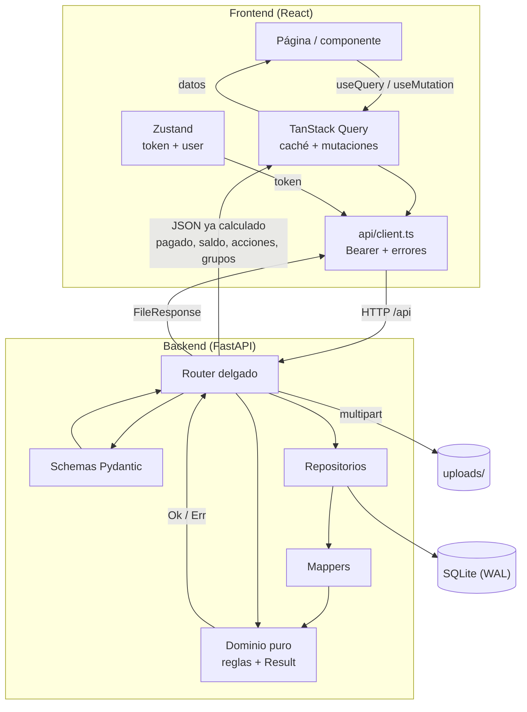

Principios del flujo:

1. **El cliente no deriva reglas.** Pide datos y acciones; el servidor decide.
2. **Una sola fuente de verdad** por agregado (`Project`).
3. **Transacciones cortas**: cargar → validar en dominio → escribir → `commit`.
4. **Invalidación explícita de caché** tras cada mutación, incluyendo módulos vecinos.

## 2. Ciclo de una petición

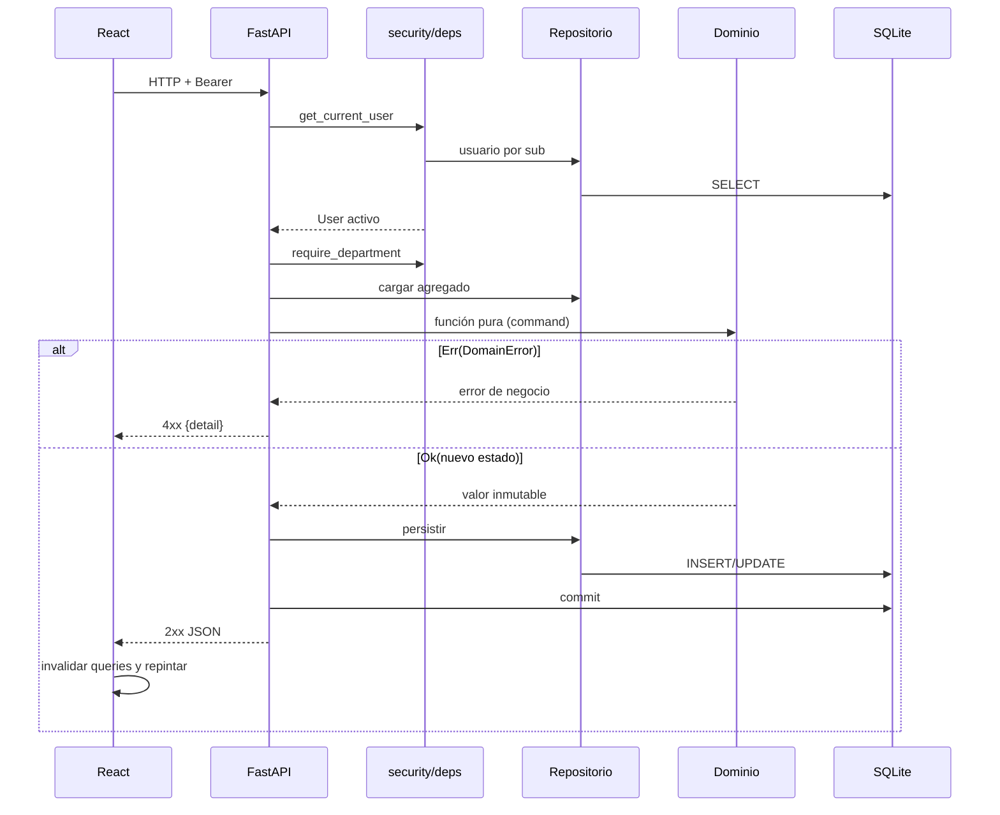

## 3. Máquinas de estado

### 3.1 Ventas

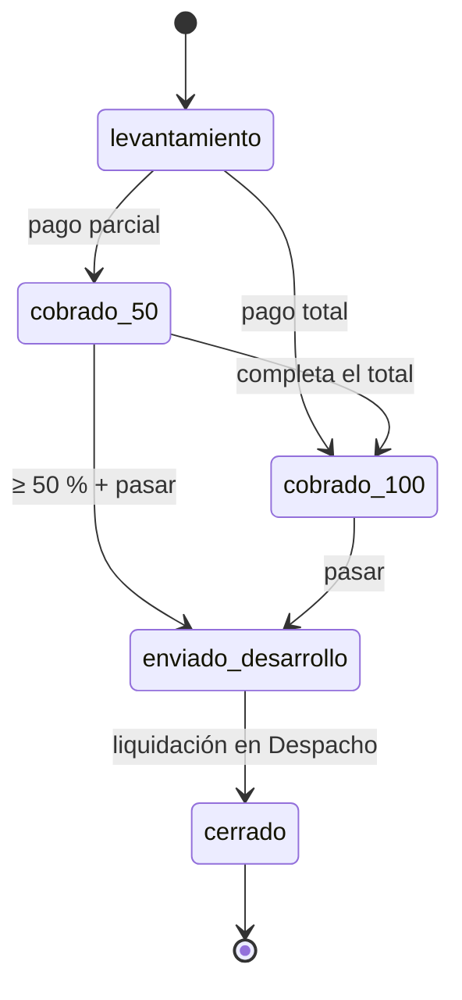

- No existe estado `borrador` ni guardado de borradores: el proyecto nace en
  `levantamiento` cuando Ventas envía el formulario completo.
- `cobrado_50` significa «hay algún pago parcial», no exactamente 50 %.
- `cerrado` se alcanza al liquidar el saldo en Despacho (o al entregar si Ventas seguía
  en `enviado_desarrollo`).

### 3.2 Producción (Desarrollo)

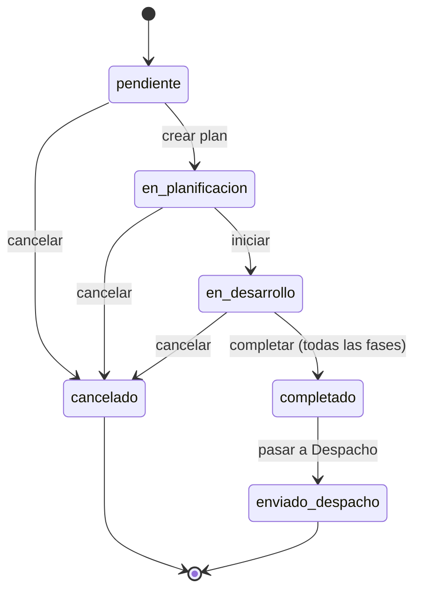

- Solo se planifica/avanza cuando Ventas ya envió el proyecto.
- Fases y avances solo se editan en `en_desarrollo`.
- La cancelación exige motivo + informe ≥ 30 caracteres y queda en el expediente.

### 3.3 Despacho

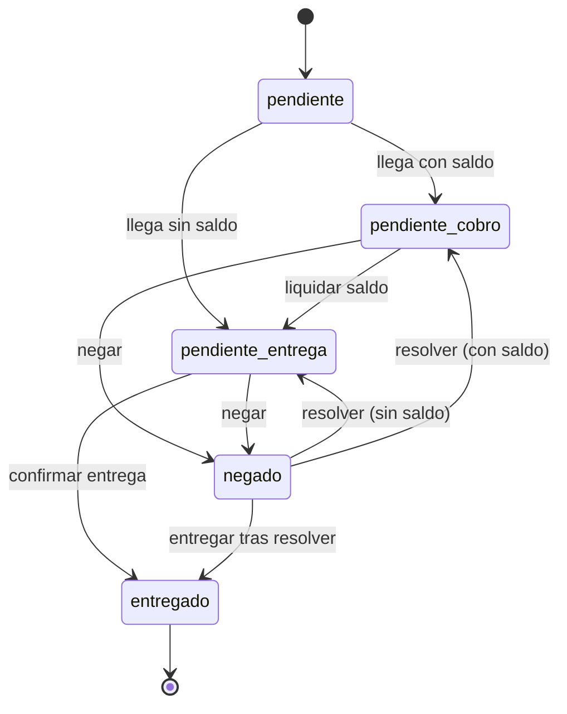

- `entregado` exige saldo 0.
- `negado` vuelve a la cola de pendientes (`cerrados` incluye `negado` y `entregado`).

### 3.4 Fases de Producción

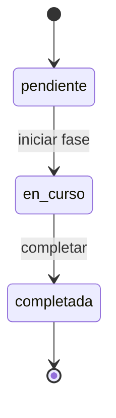

### 3.5 Incidencias

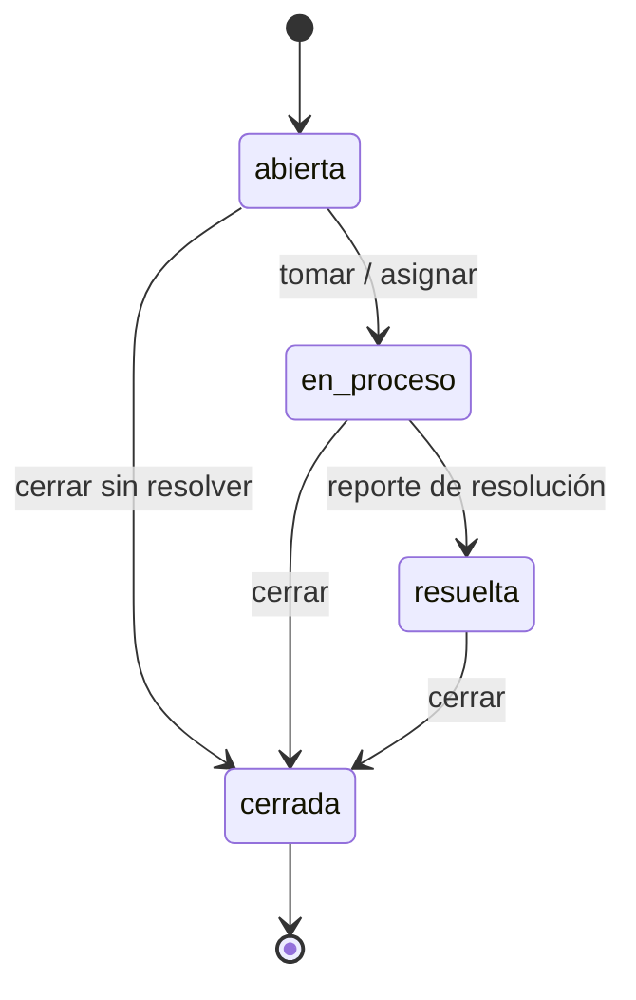

`POST /reporte` hace automáticamente `abierta → en_proceso → resuelta` si hacía falta.

## 4. Recorrido completo de un proyecto

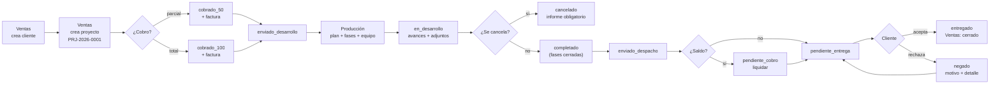

## 5. Secuencias por caso de uso

### 5.1 Login y enrutado por rol

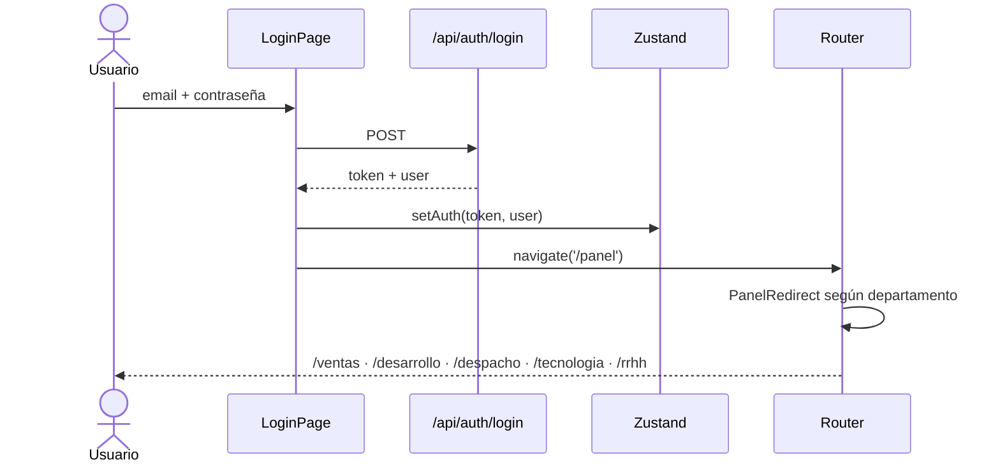

### 5.2 Alta de cliente y proyecto (Ventas)

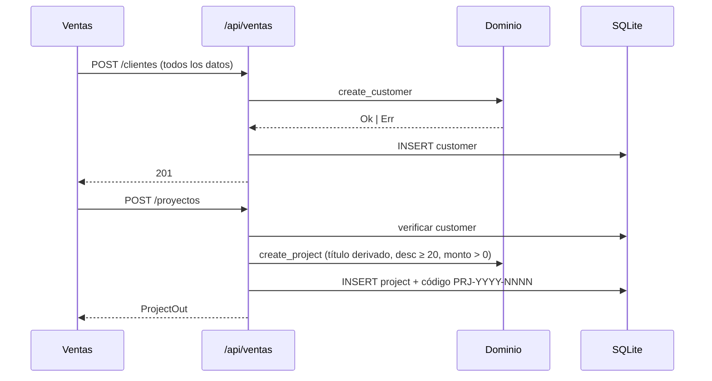

### 5.3 Cobro y factura (Ventas)

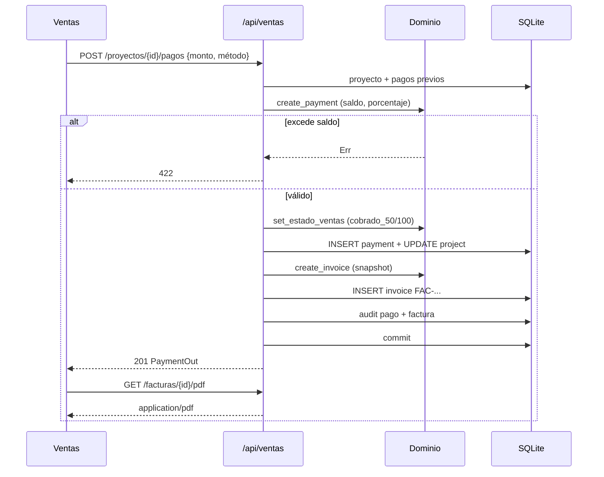

### 5.4 Plan, fases y avance (Producción)

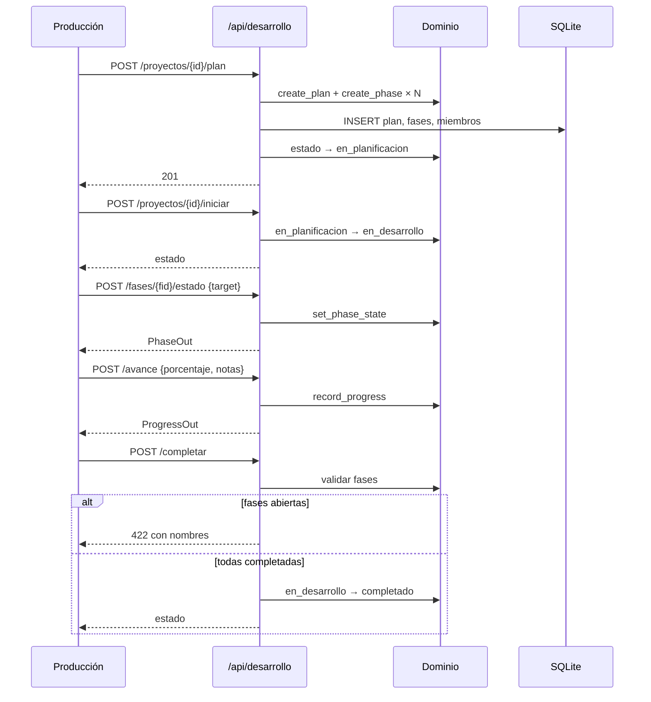

### 5.5 Liquidación y entrega (Despacho)

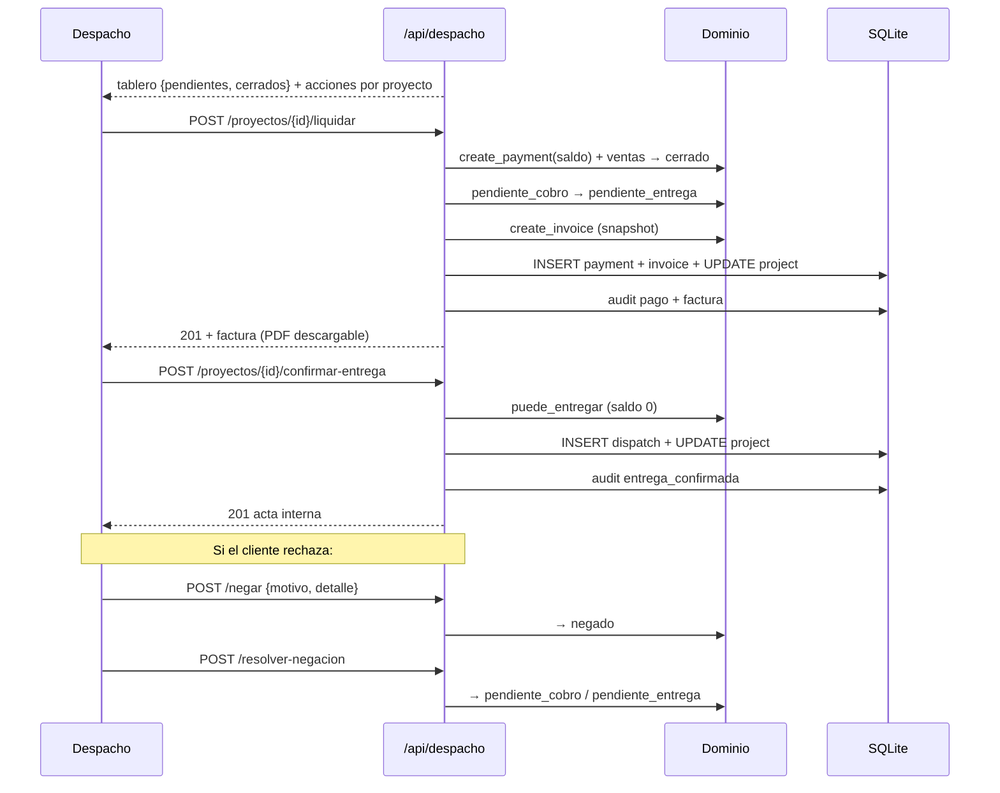

### 5.6 Incidencia (cualquier departamento → Tecnología)

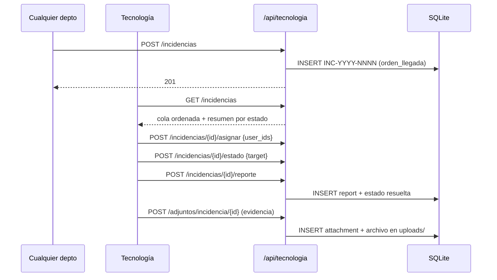

### 5.7 Adjunto

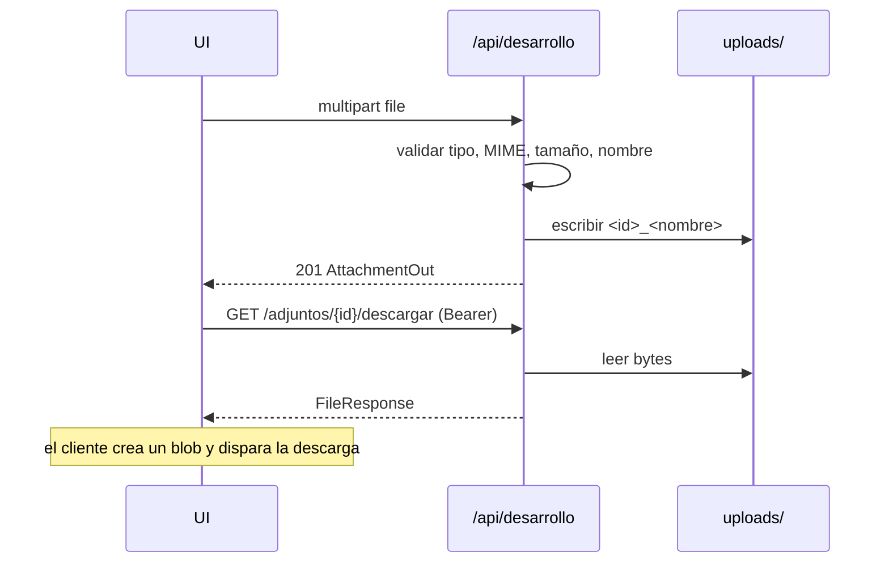

### 5.8 Búsqueda global

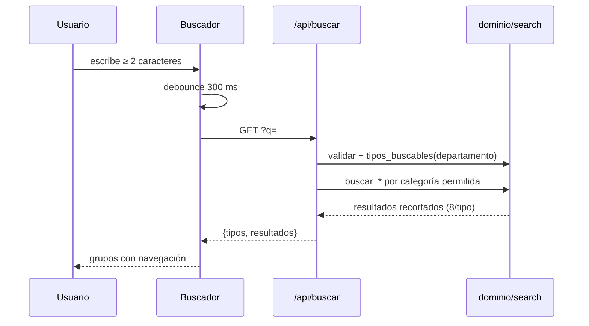

## 6. Flujo de usuarios por rol

### 6.1 Vista general

```mermaid
flowchart TD
    A["Login"] --> B{"Rol"}
    B --> V["Ventas"]
    B --> P["Producción"]
    B --> D["Despacho"]
    B --> T["Tecnología"]
    B --> R["RRHH"]

    V --> V1["Clientes"]
    V --> V2["Proyectos / levantamiento"]
    V --> V3["Cobros + factura PDF"]
    V --> V4["Enviar a Producción"]
    V --> V5["Reportar incidencia"]

    P --> P1["Tablero recibidos/en curso/historial"]
    P --> P2["Plan + fases + equipo"]
    P --> P3["Avances + adjuntos"]
    P --> P4["Completar / enviar a Despacho"]
    P --> P5["Cancelar con informe"]

    D --> D1["Cola pendientes/cerrados"]
    D --> D2["Contacto y saldo"]
    D --> D3["Liquidar"]
    D --> D4["Confirmar entrega / negar"]

    T --> T1["Cola por prioridad + llegada"]
    T --> T2["Asignar técnicos"]
    T --> T3["Reporte + evidencia"]

    R --> R1["Panel global (KPIs)"]
    R --> R2["Usuarios: alta/edición/bloqueo"]
    R --> R3["Proyectos globales"]
    R --> R4["Bitácora"]
```

### 6.2 Ventas

1. Entra y ve la lista de proyectos y clientes.
2. Da de alta el cliente (todos los datos obligatorios).
3. Crea el proyecto con monto y detalles.
4. Registra el pago (50 %, 100 % o parcial); el sistema emite factura PDF.
5. Cuando el cobro alcanza el 50 %, aparece «Enviar a Producción».
6. Tras enviarlo, deja de gestionarlo (sus acciones quedan vacías).
7. En cualquier momento puede reportar una incidencia de Tecnología.

### 6.3 Producción

1. Ve columnas **Recibidos**, **En curso**, **Historial**.
2. En «Recibidos» crea el plan, fases y asigna miembros de Producción.
3. Inicia el desarrollo.
4. Actualiza fases y registra avances con notas.
5. Adjunta documentos/imágenes al proyecto, fases o plan.
6. Cuando todas las fases están completadas, marca «Completado».
7. Envía a Despacho (el saldo decide si espera cobro o entrega).
8. Si el proyecto se frustra, cancela con motivo + informe.

### 6.4 Despacho

1. Ve **Pendientes** y **Cerrados**.
2. Abre el proyecto y contacta al cliente con los datos del levantamiento.
3. Si hay saldo, «Liquidar saldo» (cobro total del resto, genera factura PDF).
4. Con saldo 0, «Confirmar entrega»: fecha, destinatario, detalle.
5. Si el cliente rechaza, «Negar» con motivo y detalle.
6. Una negación se puede resolver y volver a la cola.

### 6.5 Tecnología

1. Ve la cola ordenada por prioridad y luego llegada.
2. Consulta el resumen por estado.
3. Asigna uno o varios técnicos.
4. Mueve estado (`abierta → en_proceso`).
5. Registra diagnóstico, solución y horas; pasa a `resuelta`.
6. Adjunta evidencia fotográfica a la incidencia.
7. Cierra (`resuelta → cerrada`).

### 6.6 RRHH

1. Panel general con KPIs de todos los departamentos.
2. Usuarios: alta, edición, cambio de departamento, bloqueo/desactivación,
   restablecimiento de contraseña.
3. Proyectos: vista global de solo lectura.
4. Bitácora: últimas acciones sensibles.
5. Puede reportar incidencias.

## 7. Flujos alternativos y errores

| Situación | Comportamiento |
|---|---|
| Credenciales inválidas | 401, mensaje genérico, auditoría `login_fallido` |
| Usuario bloqueado/desactivado | 403 con motivo; el token deja de servir |
| Token expirado | 401 → el cliente limpia sesión y vuelve a login |
| Intento de acción de otro módulo | 403 con departamento requerido |
| Proyecto sin cliente válido | 404 al crear |
| Cliente con proyectos | 422 al intentar borrarlo |
| Descripción corta / monto ≤ 0 | 422 |
| Pago mayor al saldo | 422 |
| Pasar a Producción sin 50 % | 422 |
| Completar con fases abiertas | 422 con lista de pendientes |
| Cancelar sin informe suficiente | 422 |
| Entregar con saldo | 422 con el saldo formateado |
| Incidencia cerrada → asignar | 422 |
| Archivo > 20 MB o MIME no permitido | 422 |
| Archivo físico desaparecido | 404 al descargar |
| Servidor caído | `ApiError(0, 'No hay conexión con el servidor')` |
| Plan ya creado | 409 |

## 8. Trazabilidad

- Cada acción sensible deja una fila en `audit_logs` (best-effort).
- Cada proyecto conserva su historia: pagos, facturas, plan, fases, avances, miembros,
  cancelación, entrega y negación.
- Los adjuntos son polimórficos y cuelgan de la entidad correspondiente.
- RRHH es el único que puede leer la bitácora completa.
