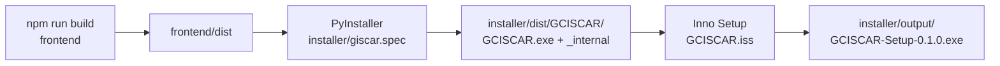
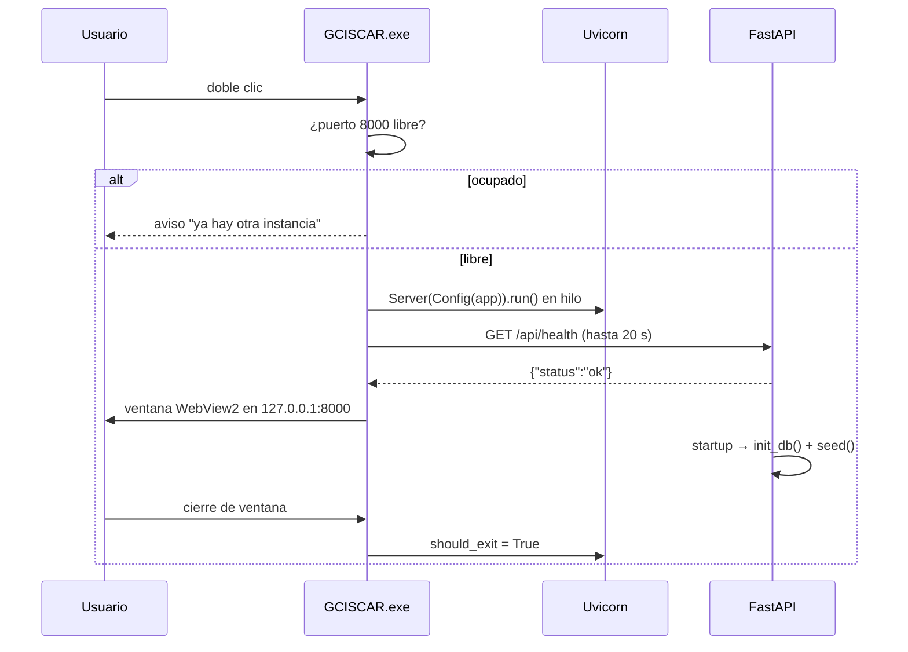

# 08 · Infraestructura y despliegue

## 1. Entornos

| Entorno | Procesos | URL | Datos |
|---|---|---|---|
| Desarrollo | Vite `:5173` + Uvicorn `:8000` (reload) | `http://127.0.0.1:5173` | `backend/giscar.db`, `backend/uploads/` |
| Producción local | Uvicorn `:8000` sirviendo `frontend/dist` | `http://127.0.0.1:8000` | igual que desarrollo |
| Instalado (`.exe`) | Uvicorn en hilo + ventana WebView2 | `http://127.0.0.1:8000` | `%LOCALAPPDATA%\GCISCAR\` |

Requisitos de la máquina:

- **Desarrollo**: Python ≥ 3.12, [`uv`](https://docs.astral.sh/uv/), Node.js ≥ 20 + npm.
- **Uso final**: Windows con WebView2 Runtime (incluido en Windows 10/11 modernos).
- **Compilación del instalador**: Inno Setup 6 (`ISCC.exe`).

## 2. Puertos y procesos

| Puerto | Servicio | Notas |
|---|---|---|
| `5173` | Vite dev server | Solo desarrollo; proxy `/api → 8000` |
| `8000` | FastAPI/Uvicorn | `127.0.0.1` (loopback), no `0.0.0.0` |

- El `.exe` comprueba si el puerto 8000 está ocupado; si lo está, muestra
  «Ya hay otra instancia de GCISCAR abierta» y no arranca.
- El lanzador espera a `GET /api/health` (hasta 20 s) antes de abrir la ventana.
- Al cerrar la ventana, `servidor.should_exit = True`.

## 3. Estructura en disco

### Repositorio (desarrollo)

```
giscar/
  backend/
    app/                 # código
    tests/
    giscar.db            # runtime (gitignored)
    uploads/             # runtime (gitignored)
    .env                 # opcional (gitignored)
    pyproject.toml
    uv.lock
  frontend/
    src/
    public/fonts/        # Inter, JetBrains Mono, Material Symbols (auto-hospedados)
    dist/                # build (gitignored)
    package.json
  installer/
    entry.py             # lanzador de escritorio
    giscar.spec          # PyInstaller
    GCISCAR.iss          # Inno Setup
    build.py             # orquestador
    dist/                # .exe portable (gitignored)
    output/              # instalador (gitignored)
  docs/
  package.json           # scripts raíz
```

### Instalación (PC destino)

```
%LOCALAPPDATA%\Programs\GCISCAR\
  GCISCAR.exe
  _internal\              # Python, dependencias, frontend/dist, fuentes
%LOCALAPPDATA%\GCISCAR\   # datos (sobreviven a desinstalar/actualizar)
  giscar.db
  giscar.db-wal
  giscar.db-shm
  uploads\
```

La separación datos/binario es deliberada (`config._base_dir()`): actualizar el `.exe` no
toca la información.

## 4. Comandos

### Raíz del repo

```bash
npm run dev       # frontend Vite :5173
npm run api       # backend Uvicorn :8000 --reload
npm run build     # typecheck + build del frontend
npm run lint      # oxlint + ruff
npm run fmt       # ruff format
npm run test      # pytest
npm run check     # build + lint + test
npm run package   # frontend + .exe + instalador
```

### Backend directo

```bash
cd backend
uv sync                                   # crear entorno e instalar
uv run uvicorn app.main:app --reload --port 8000
uv run giscar-backend                     # entrypoint (app.main:run)
uv run pytest -q
uv run ruff check .
uv run mypy app                           # opcional (ignore_missing_imports)
```

### Frontend directo

```bash
cd frontend
npm install
npm run dev
npm run build
npm run lint
npm run preview
```

### Producción local (sin .exe)

```bash
cd frontend && npm run build
cd ../backend && uv run giscar-backend
# abrir http://127.0.0.1:8000
```

## 5. Pipeline de empaquetado



`installer/build.py`:

1. Ejecuta `npm --prefix frontend run build` (falla si el typecheck no pasa).
2. Ejecuta PyInstaller con `--noconfirm --clean`, `distpath=installer/dist`,
   `workpath=installer/build`.
3. Si no se pasa `--exe`, busca `ISCC.exe` (PATH o `Program Files (x86)\Inno Setup 6`) y
   compila el instalador; si no lo encuentra, termina con error.

### Detalles de `giscar.spec`

- Entrada: `installer/entry.py`.
- `pathex`: `backend/`.
- Datos incluidos:
  - `frontend/dist` → `frontend/dist` (para `sys._MEIPASS`);
  - `collect_data_files("reportlab")` (fuentes AFM/PFB);
  - `collect_data_files("webview")` (DLLs de WebView2).
- `hiddenimports`: todos los submódulos de `uvicorn`, dialecto SQLite de SQLAlchemy y
  `webview` (imports dinámicos).
- `excludes`: `mypy`.
- `onedir` (`COLLECT`), `console=False`, UPX.

### Detalles de `GCISCAR.iss`

- Instalación **por usuario** (`PrivilegesRequired=lowest`), sin administrador.
- Destino: `{localappdata}\Programs\GCISCAR`.
- Copia recursiva de `dist\GCISCAR\*`.
- Accesos en menú Inicio y, opcional, escritorio.
- Idioma español; compresión LZMA2.
- Al terminar ofrece lanzar la app.

## 6. Arranque en runtime



- `main.py` monta `/assets` y el fallback SPA si existe `frontend/dist`.
- El fallback:
  - rechaza `api/*` con 404;
  - sirve archivos reales (fuentes, favicon);
  - en cualquier otra ruta devuelve `index.html` para React Router.
- `init_db()` crea tablas y aplica parches idempotentes.
- `seed()` crea las cuentas iniciales si faltan.

## 7. Datos, backup y restauración

### Ubicación

| Entorno | BD | Adjuntos |
|---|---|---|
| Dev | `backend/giscar.db` | `backend/uploads/` |
| Instalado | `%LOCALAPPDATA%\GCISCAR\giscar.db` | `%LOCALAPPDATA%\GCISCAR\uploads\` |

### Backup recomendado

1. Cerrar GCISCAR (evita escrituras).
2. Copiar la carpeta de datos completa (`giscar.db*` y `uploads/`).
3. Guardar con fecha; conservar al menos N copias.
4. Probar la restauración en una copia.

Alternativa en caliente:

```bash
sqlite3 giscar.db ".backup 'giscar-backup.db'"
```

### Restauración

1. Cerrar la app.
2. Reemplazar `giscar.db*` y `uploads/` por la copia.
3. Abrir la app (aplica PRAGMAs y parches de `init_db`).

### Reset

```bash
cd backend
rm -f giscar.db giscar.db-wal giscar.db-shm
uv run python -m app.infrastructure.db.seed
```

## 8. Configuración

Archivo `backend/.env` (desarrollo) o variables de entorno (instalado):

```env
GISCAR_JWT_SECRET=<aleatorio de 32+ bytes>
GISCAR_ACCESS_TOKEN_MINUTES=480
GISCAR_MAX_UPLOAD_MB=20
# GISCAR_DATABASE_URL=sqlite:///C:/ruta/giscar.db
# GISCAR_UPLOADS_DIR=C:/ruta/uploads
# GISCAR_CORS_ORIGINS=["http://127.0.0.1:5173"]
```

Prioridad: variables de entorno > `.env` > defaults de `Settings`.

En el `.exe`, `BASE_DIR` es `%LOCALAPPDATA%\GCISCAR`; el `.env` se buscaría allí, no en la
carpeta del ejecutable. Para cambiar el secreto en una instalación, definir la variable
de entorno del sistema/usuario antes de abrir la app.

## 9. Logs y diagnóstico

- Uvicorn: nivel `warning` en el `.exe`; en desarrollo, salida por consola.
- El `.exe` no abre consola (`console=False`); `stdout/stderr` se redirigen a `nul`.
- No hay logging estructurado, métricas ni tracing.
- Diagnóstico:
  - `GET /api/health`;
  - Swagger `/docs`;
  - `audit_logs` (solo RRHH);
  - `PRAGMA integrity_check` sobre la BD;
  - comprobar que `uploads/` contiene los archivos referenciados.

## 10. Actualización y rollback

1. Compilar un nuevo instalador con versión incrementada en `GCISCAR.iss`.
2. Instalar encima: reemplaza binarios en `Programs\GCISCAR`.
3. Los datos de `%LOCALAPPDATA%\GCISCAR` se conservan.
4. `init_db` aplica los parches de esquema necesarios.
5. Rollback: reinstalar la versión anterior; **verificar compatibilidad de esquema**
   (no hay migraciones con downgrade).

Antes de actualizar en uso real: backup completo y prueba en una máquina/copia.

## 11. Limitaciones operativas

| Tema | Límite actual |
|---|---|
| Concurrencia de escritura | SQLite serializa; `busy_timeout=5 s` |
| Usuarios | 25–100 previstos en una sola instancia |
| Red | Escucha solo en loopback; no está preparado para LAN/internet |
| TLS | No incluido |
| Colas/background jobs | No hay; PDFs y cálculos son síncronos |
| Alta disponibilidad | No hay; un PC = un punto de fallo |
| Observabilidad | Solo healthcheck y bitácora |
| Escalado | Migrar a PostgreSQL + servidor dedicado si crece |

## 12. Solución de problemas

| Síntoma | Causa probable | Acción |
|---|---|---|
| «Ya hay otra instancia» | Puerto 8000 ocupado | Cerrar la otra ventana/proceso |
| «No se pudo iniciar el servidor local» | Puerto ocupado, antivirus, error de arranque | Revisar 8000; ejecutar en consola para ver el error |
| La app abre sin estilos/404 en assets | `frontend/dist` no existe o build incompleto | `npm run build`; reempaquetar |
| Deep link devuelve 404 | Estáticos no montados (sin `dist`) | Construir el frontend o usar Vite en dev |
| `database is locked` | Otra instancia o transacción larga | Cerrar instancias; `busy_timeout`; reintentar |
| No se ven iconos | Fuentes no copiadas a `public/fonts/` | Rebuild; verificar `fonts.css` e `icons.svg` |
| El `.exe` no arranca | Falta WebView2, DLLs o hiddenimports | Instalar WebView2; revisar `warn-giscar.txt` |
| Datos «desaparecen» tras actualizar | Se buscó la BD en otra ruta | Usar `%LOCALAPPDATA%\GCISCAR` |
| PDF de factura falla | Fuentes de reportlab no empaquetadas | Verificar `collect_data_files("reportlab")` |
| Adjunto 404 | Archivo borrado de `uploads/` | Restaurar backup o volver a subirlo |

## 13. Checklist de despliegue

- [ ] `npm run check` en verde (build + lint + 192 tests).
- [ ] `GISCAR_JWT_SECRET` cambiado.
- [ ] Contraseñas semilla cambiadas / cuentas demo desactivadas.
- [ ] Backup inicial de la BD y `uploads/`.
- [ ] Verificar que solo escucha en `127.0.0.1:8000`.
- [ ] Probar login de cada departamento.
- [ ] Probar un flujo completo con datos de prueba.
- [ ] Probar descarga de factura PDF y de un adjunto.
- [ ] Documentar la ruta de datos y el procedimiento de backup al responsable.
